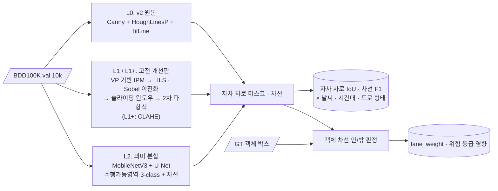

<div align="center">

# 🛣️ Lane: Hough vs Segmentation

**차선 · 주행가능영역 검출: 고전 Hough 파이프라인과 의미 분할 모델의 조건별 비교**


> FCW v2의 차선 검출(Canny + HoughLinesP)은 맑은 날 직선 도로에서는 잘 동작합니다.<br/>
> **곡선·야간·우천**에서는 어떨까요? 분할 모델과 같은 기준으로 비교하고, 차선 오류가 **위험도 판단까지 어떻게 번지는지** 추적합니다.

</div>

## 📊 결과 요약

BDD100K val **10,000장**, GT 객체 **114,726개** 기준. 전체 분석은 **[최종 보고서](results/REPORT.md)**.

| 방법 | 검출률 | 자차 차로 IoU | 차선 F1@5px | 차선 안/밖 판정 불일치 | 위험 등급 변경 | 속도 |
|---|---:|---:|---:|---:|---:|---|
| L0 v2 Hough | 64.4% | 0.220 | 0.151 | 44.1% | 17.2% | 107 FPS (CPU) |
| L1 IPM + 다항식 | 89.4% | 0.266 | 0.160 | 26.7% | 10.4% | 98 FPS (CPU) |
| L1+ L1 + CLAHE | 97.8% | 0.282 | 0.151 | 22.2% | 8.6% | 86 FPS (CPU) |
| **L2 분할** | **99.9%** | **0.799** | **0.855** | **10.1%** | **3.8%** | 33 FPS (RTX 5060 Ti) |

- **고전 기법의 한계는 조건보다 구조에 있습니다.** 고전 기법은 맑은 주간에도 IoU가 0.3 이하이고,
  날씨 · 시간대에 따른 차이는 0.01~0.04입니다. 가장 큰 실패 요인은 곡선이 아니라 **차선 표시가 없는 장면**입니다.
- **IPM 개선의 효과는 주로 검출률**(64% → 98%)이고, CLAHE는 야간 검출률을 13%p 올립니다.
- **L2의 약점은 비 · 눈**입니다 (IoU 0.74~0.77, 맑음 0.81).
- **차선 오류는 위험도 오류로 번집니다.** 판정이 틀린 객체의 약 40%가 위험 등급이 바뀝니다. L0은 검출에
  실패하면 객체를 전부 "차선 안"으로 보기 때문에 과경보 쪽으로 틀립니다. 개선판일수록 GT DANGER를 낮추는
  미경보 쪽 오류가 늘어납니다 (L0 6.7% → L1+ 16.6%, L2 10.6%).
- 정확한 차로 마스크를 쓰려면 v2의 판정 기준점(박스 중심)을 **박스 아랫변 중앙**으로 바꿔야 합니다.

<p align="center">
  
  
</p>

---

## 📌 문제 정의

[FCW v2](https://github.com/cbnu-yhjeon/monocular-forward-collision-warning)의 `lane.py`는 기울기로 좌·우 차선을 나누고 `fitLine`으로 직선 하나씩만 맞춥니다. 그래서 곡선 도로에서 차선 마스크가 어긋납니다. 이 마스크는 위험도의 `lane_weight`(차선 안 ×1.1, 밖 ×0.85)에 바로 쓰이므로, 차선 오류는 곧 위험도 오류가 됩니다.

## 🎯 목표

| # | 목표 | 결과 |
|:---:|---|---|
| G1 | 고전 파이프라인 개선판(IPM + 슬라이딩 윈도우 + 2차 다항식) 구현 | [`ipm_poly.py`](src/lanebench/classical/ipm_poly.py) — L1, L1+ |
| G2 | 의미 분할 모델로 차선 · 주행가능영역 검출 | [`model.py`](src/lanebench/segmentation/model.py) — L2 |
| G3 | 날씨 · 시간대 · 도로 형태별로 실패 조건 분석 | [`by_condition.py`](src/lanebench/eval/by_condition.py), 히트맵 |
| G4 | 차선 오류가 객체의 "차선 안/밖" 판단과 위험 등급에 주는 영향 측정 | [`in_lane.py`](src/lanebench/impact/in_lane.py), 영향 표 |

---

## 🔗 기반 수업과 저장소

| 수업 / 프로젝트 | 가져온 것 | 저장소 |
|---|---|---|
| 산업 컴퓨터비전 Lec 5 | Canny, Hough Transform | [industrial_computor_vision](https://github.com/cbnu-yhjeon/industrial_computor_vision) |
| 산업 컴퓨터비전 Lec 9 | Perspective Warping (IPM), 호모그래피 | 〃 |
| 산업 컴퓨터비전 Final | `lane.py`, 위험도의 `lane_weight` | [monocular-forward-collision-warning](https://github.com/cbnu-yhjeon/monocular-forward-collision-warning) |
| 지능화 캡스톤 (11주차) | 딥러닝 의미 분할 실습 | [capston-pilot](https://github.com/cbnu-yhjeon/capston-pilot) |
| 영상처리 실체 | 엣지 검출, 기하 변환 | [Image-Processing-Entities](https://github.com/cbnu-yhjeon/Image-Processing-Entities) |

---

## 🧭 접근 방법



| ID | 방법 | 구현 |
|:---:|---|---|
| L0 | v2 `preprocessing.py` + `lane.py`를 파라미터까지 그대로 이식 | [`hough_v2.py`](src/lanebench/classical/hough_v2.py) |
| L1 | 소실점(VP) 기준 IPM → BEV에서 흰색 top-hat · 노란색 HLS · Sobel-x 이진화 → 슬라이딩 윈도우 → 2차 다항식 → 역변환 | [`ipm_poly.py`](src/lanebench/classical/ipm_poly.py) |
| L1+ | L1 + 밝기 채널 CLAHE (Lec 3) | 〃 |
| L2 | MobileNetV3-Large(ImageNet) + U-Net 디코더, 주행가능영역 3-class + 차선 헤드, 640×360, train 69k장 5 epoch | [`model.py`](src/lanebench/segmentation/model.py), [`train.py`](src/lanebench/segmentation/train.py) |

방법 · 지표 · 영향 분석의 정의와 전체 결과는 **[최종 보고서](results/REPORT.md)** 에 있습니다.

---

## 🗂️ 데이터

| 데이터 | 용도 | 출처 |
|---|---|---|
| BDD100K 100k train 70k / val 10k 이미지 | 학습 · 평가 | Hugging Face 공개 재배포본 (`yiyi159/bdd100k-train`, `hirundo-io/bdd100k-val`) |
| BDD100K v1 per-image 라벨 | 박스 · 차선 poly2d · 주행가능영역 poly2d · 날씨/시간대/장면 | YOLOP 배포 `det_annotations.zip` |

공식 다운로드 서버(dl.cv.ethz.ch)가 닫혀 있어 공개 재배포본을 썼습니다 ([`scripts/fetch_data.sh`](scripts/fetch_data.sh)).
BDD100K는 자체 라이선스(연구 · 교육 목적)를 따르며, 원본 데이터는 저장소에 넣지 않습니다.

- **자차 차로 GT** = BDD `area/drivable`(*direct*) polygon
- **차선 GT** = 종방향(parallel) 페인트 차선 (횡단보도 · 연석 제외), 베지어 곡선은 펼쳐서 래스터화
- **도로 형태** = BDD에 속성이 없어 GT 차선의 sagitta/chord로 직선 · 곡선 판정

---

## 🚀 실행

```bash
pip install -e ".[dev]"            # PyTorch는 CUDA 버전에 맞게 따로 설치
bash scripts/fetch_data.sh          # → ~/data (경로는 LANEBENCH_IMAGES / LANEBENCH_LABELS로 변경 가능)
bash scripts/run_all.sh             # manifest → L2 학습 · 추론 → 평가 → 집계 · 그림 · 속도
pytest -q                           # 단위 테스트 19개
```

단계별로는:

```bash
python -m lanebench.data.manifest                         # 이미지 · 라벨 · 조건 목록
python -m lanebench.segmentation.train --epochs 5         # L2 학습 (RTX 5060 Ti 약 1시간)
python -m lanebench.segmentation.infer --split val        # L2 예측 PNG 저장
python -m lanebench.eval.run --methods L0 L1 L1+          # 고전 기법 평가 (CPU 병렬, 약 2분)
python -m lanebench.eval.run --methods L2                 # 저장된 L2 예측 평가
python -m lanebench.eval.by_condition                     # results/metrics/*.csv, summary.md
python -m lanebench.eval.figures                          # results/figures/*.png
python -m lanebench.eval.qualitative                      # 실패 사례 패널
python -m lanebench.eval.fps                              # 속도
```

## 📁 디렉토리 구조

```
Lane-Hough-vs-Segmentation/
├── src/lanebench/
│   ├── data/           bdd.py (라벨 로더 · 래스터화) · manifest.py (조건 · 도로 형태)
│   ├── classical/      hough_v2.py (L0) · ipm_poly.py (L1 · L1+)
│   ├── segmentation/   model.py · dataset.py · train.py · infer.py (L2)
│   ├── impact/         in_lane.py · risk_v2.py (위험도 영향)
│   └── eval/           miou.py · lane_f1.py · run.py · by_condition.py · figures.py · qualitative.py · fps.py
├── tests/              단위 테스트
├── scripts/            fetch_data.sh · run_all.sh
└── results/
    ├── REPORT.md       최종 보고서
    ├── metrics/        집계 표 (CSV · summary.md)
    └── figures/        히트맵 · 막대 그래프 · 정성 비교
```

## ⚠️ 한계

| 한계 | 내용 |
|---|---|
| IPM 보정 | BDD100K는 카메라 정보가 없어 소실점으로 근사. Hough 교점이 흩어지는 영상이 많아 상당수는 학습 셋 평균 VP를 씁니다 |
| 차선 F1 비교 | 고전 기법은 자차 차로 좌우 두 줄만 내므로 모든 차선을 GT로 하는 recall이 구조적으로 낮습니다 |
| 위험도 영향 | GT 박스에는 특징점 · TTC · 거리가 없어 v2 위험도의 해당 항을 기본값으로 둡니다. `lane_weight`만의 영향을 분리해서 본 결과입니다 |
| 영상 단위 | 시간 축(추적 · 평활화) 없이 프레임마다 독립 평가 |

## 📚 참고 자료

- F. Yu et al., *BDD100K: A Diverse Driving Dataset for Heterogeneous Multitask Learning*, CVPR 2020
- A. Howard et al., *Searching for MobileNetV3*, ICCV 2019
- O. Ronneberger et al., *U-Net*, MICCAI 2015
- D. Wu et al., *YOLOP: You Only Look Once for Panoptic Driving Perception*, 2021 (라벨 배포본)
- 산업 컴퓨터비전 Lec 3 · 5 · 9 강의 자료
