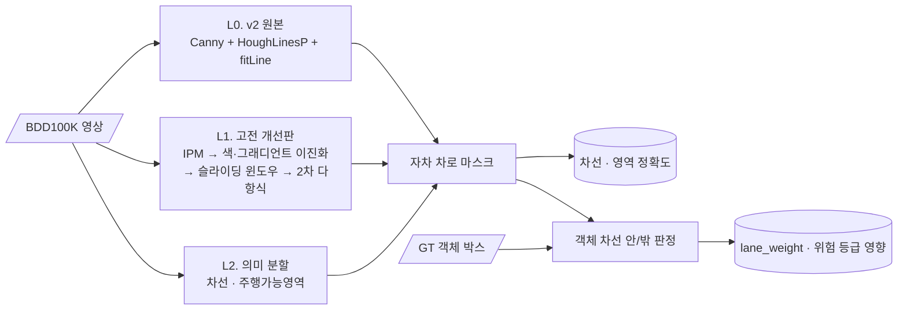

<div align="center">

# 🛣️ Lane: Hough vs Segmentation

**차선 · 주행가능영역 검출: 고전 Hough 파이프라인과 의미 분할 모델의 조건별 비교**


> FCW v2의 차선 검출(Canny + HoughLinesP)은 맑은 날 직선 도로에서는 잘 동작합니다.<br/>
> **곡선·야간·우천**에서는 어떨까요? 분할 모델과 같은 기준으로 비교하고, 차선 오류가 **위험도 판단까지 어떻게 번지는지** 추적합니다.

</div>

> [!NOTE]
> 🚧 **계획 단계입니다.** 아직 코드가 없고, 이 README는 프로젝트 설계서입니다.

---

## 📌 문제 정의

[FCW v2](https://github.com/cbnu-yhjeon/monocular-forward-collision-warning)의 `lane.py`는 기울기로 좌·우 차선을 나누고 `fitLine`으로 직선 하나씩만 맞춥니다. 그래서 곡선 도로에서 차선 마스크가 어긋납니다. 이 마스크는 위험도의 `lane_weight`(차선 안 ×1.1, 밖 ×0.85)에 바로 쓰이므로, 차선 오류는 곧 위험도 오류가 됩니다.

## 🎯 목표

| # | 목표 |
|:---:|---|
| G1 | 고전 파이프라인 개선판(IPM + 슬라이딩 윈도우 + 2차 다항식) 구현 |
| G2 | 의미 분할 모델로 차선 · 주행가능영역 검출 |
| G3 | 날씨 · 시간대 · 도로 형태별로 실패 조건 분석 |
| G4 | 차선 오류가 객체의 "차선 안/밖" 판단과 위험 등급에 주는 영향 측정 |

---

## 🔗 기반 수업과 저장소

| 수업 / 프로젝트 | 가져올 것 | 저장소 |
|---|---|---|
| 산업 컴퓨터비전 Lec 5 | Canny, Hough Transform | [industrial_computor_vision](https://github.com/cbnu-yhjeon/industrial_computor_vision) |
| 산업 컴퓨터비전 Lec 9 | Perspective Warping (IPM), 호모그래피 | 〃 |
| 산업 컴퓨터비전 Final | `lane.py`, 위험도의 `lane_weight` | [monocular-forward-collision-warning](https://github.com/cbnu-yhjeon/monocular-forward-collision-warning) |
| 지능화 캡스톤 (11주차) | 딥러닝 의미 분할 실습 | [capston-pilot](https://github.com/cbnu-yhjeon/capston-pilot) |
| 영상처리 실체 | 엣지 검출, 기하 변환 | [Image-Processing-Entities](https://github.com/cbnu-yhjeon/Image-Processing-Entities) |

---

## 🧭 접근 방법



1. **L0:** v2의 `lane.py`를 그대로 씁니다.
2. **L1:** 원근 변환으로 도로를 위에서 본 시점(IPM)으로 펴고, HLS 색공간 임계값과 Sobel 그래디언트로 차선 픽셀을 뽑습니다. 슬라이딩 윈도우로 픽셀을 모은 뒤 2차 다항식을 맞추고, 원래 시점으로 되돌립니다.
3. **L2:** 경량 분할 모델(예: DeepLabV3 MobileNet 백본, U-Net)을 BDD100K로 학습합니다.
4. **영향 분석:** 세 방법의 차로 마스크로 GT 객체마다 "차선 안/밖"을 판정합니다. 그리고 GT 주행가능영역 기준 판정과의 불일치율, 그로 인한 위험 등급 변화를 셉니다.

---

## 🗂️ 데이터

| 데이터 | 용도 | 비고 |
|---|---|---|
| [BDD100K](https://bdd-data.berkeley.edu/) | 학습 · 평가 | 차선 마킹 · 주행가능영역 라벨, 날씨 · 시간대 · 장면 속성 |
| 공개 대시캠 영상 (FCW v2와 동일) | 정성 비교 | |

> BDD100K는 자체 라이선스(연구 목적)를 따릅니다. 원본 데이터는 저장소에 넣지 않습니다.

---

## 🧪 실험 설계

| ID | 방법 | 목적 |
|:---:|---|---|
| L0 | v2 Hough 직선 | 기준선 |
| L1 | IPM + 다항식 | 고전 기법의 개선 여지 |
| L2 | 의미 분할 | 딥러닝 기준선 |
| L1+ | L1에 CLAHE(Lec 3) 추가 | 야간 보완 효과 |

### 지표

| 영역 | 지표 |
|---|---|
| 주행가능영역 | mIoU |
| 차선 | 픽셀 허용 오차 내 F1 |
| 조건별 분석 | 날씨(맑음 · 비 · 눈 · 안개) × 시간대(주간 · 야간 · 새벽/황혼)별 위 지표 |
| 위험도 영향 | 객체 차선 안/밖 판정 불일치율, 위험 등급이 바뀐 객체 비율 |
| 속도 | FPS (CPU / GPU) |

---

## 🗓️ 마일스톤

| 주차 | 내용 | 산출물 |
|:---:|---|---|
| 1 | BDD100K 로더, 조건 속성별 분할, 평가 코드 | 공통 평가 |
| 2 | L0 이식, L1 구현 | 고전 기법 결과 |
| 3 | L2 학습 | 분할 모델 결과 |
| 4 | 조건별 분석 | 날씨 × 시간대 히트맵 |
| 5 | 위험도 영향 분석, L1+ | 영향 표 |
| 6 | 실패 사례 정리 | 최종 보고서 |

## 📁 디렉토리 구조 (계획)

```
Lane-Hough-vs-Segmentation/
├── src/
│   ├── classical/      hough_v2.py · ipm_poly.py
│   ├── segmentation/   model.py · train.py
│   ├── impact/         in_lane.py (위험도 영향)
│   └── eval/           miou.py · lane_f1.py · by_condition.py
├── results/
└── README.md
```

## ⚠️ 리스크와 대응

| 리스크 | 대응 |
|---|---|
| IPM 변환 행렬이 카메라마다 다름 | BDD100K는 카메라 정보가 제한적이라 소실점 기반으로 근사하고, 오차를 함께 보고 |
| 차선 라벨(선)과 분할 출력(영역)의 형식 차이 | 선 라벨을 일정 두께로 래스터화해 같은 형식으로 비교 |
| 학습 자원 | 해상도 축소, 경량 백본 사용 |

## 📚 참고 자료

- F. Yu et al., *BDD100K: A Diverse Driving Dataset for Heterogeneous Multitask Learning*, CVPR 2020
- L.-C. Chen et al., *Rethinking Atrous Convolution for Semantic Image Segmentation* (DeepLabV3), 2017
- O. Ronneberger et al., *U-Net*, MICCAI 2015
- 산업 컴퓨터비전 Lec 5 · 9 강의 자료
