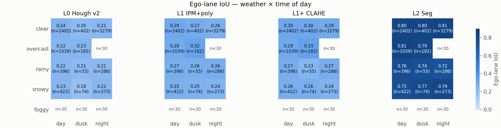
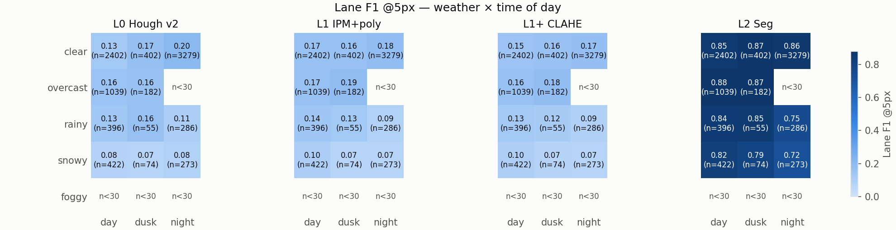
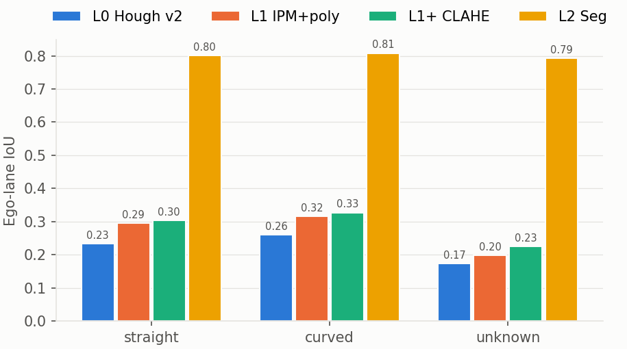
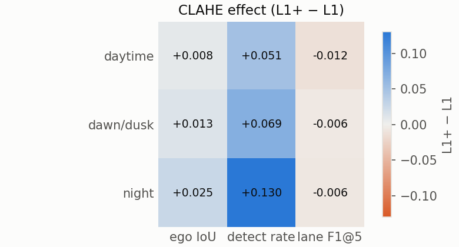
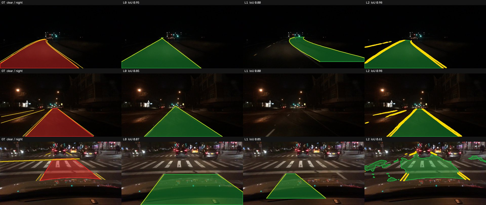
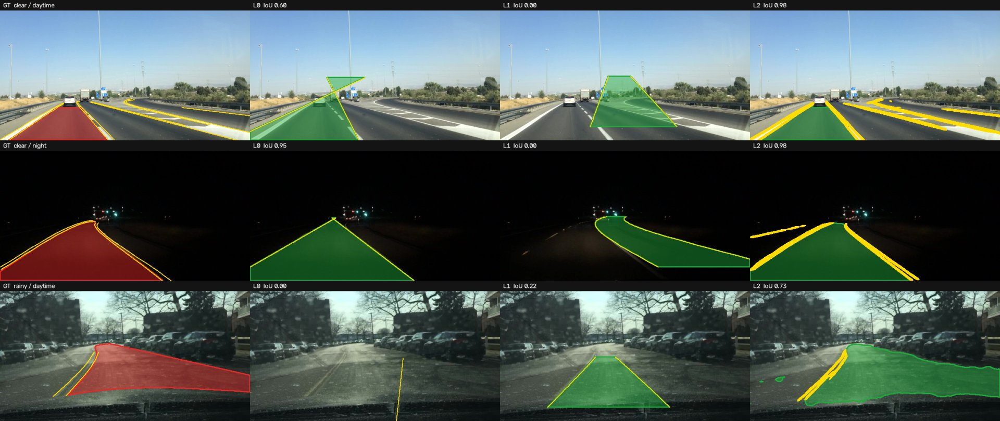
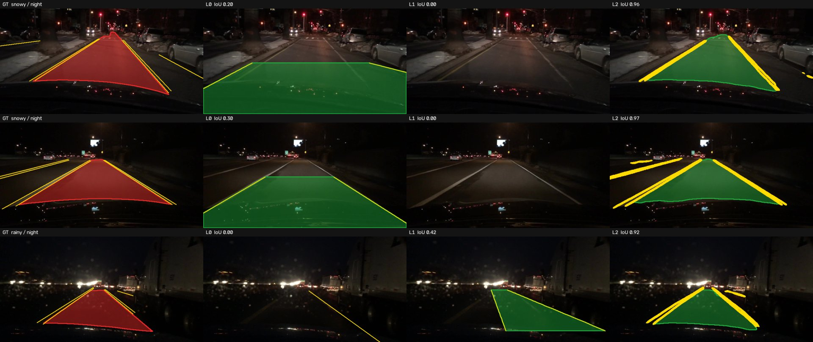
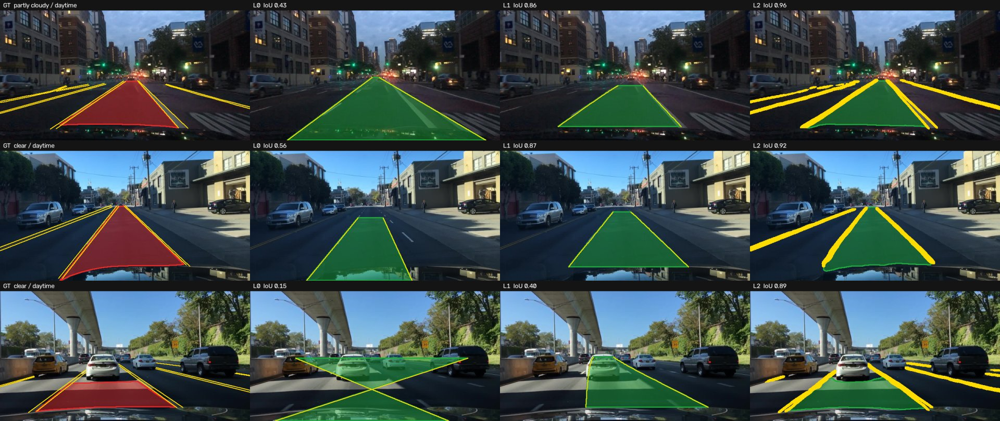
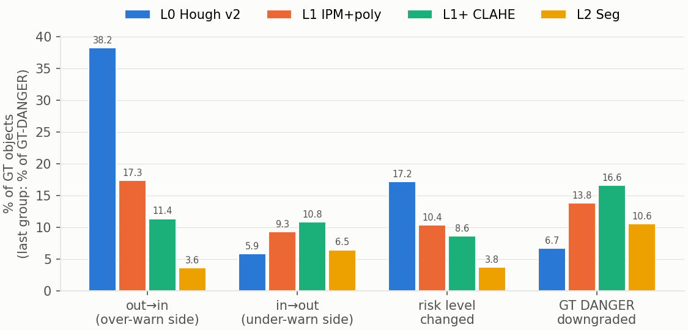

# 최종 보고서 — Lane: Hough vs Segmentation

BDD100K val 10,000장에서 FCW v2의 Hough 차선 검출(L0), 고전 개선판(L1, L1+),
의미 분할 모델(L2)을 같은 기준으로 비교했습니다. 그리고 차선 오류가 FCW 위험도의
`lane_weight`를 거쳐 위험 등급까지 어떻게 번지는지 GT 객체 11만여 개로 셌습니다.

> 모든 수치는 `python -m lanebench.eval.by_condition`이 만든 `results/metrics/*.csv`에서
> 옮겼습니다. 표 전체는 [`metrics/summary.md`](metrics/summary.md)에 있습니다.

## 한눈에

| 방법 | 검출률 | 자차 차로 IoU | 차선 P@5 | 차선 R@5 | 차선 F1@5 | 속도 |
|---|---:|---:|---:|---:|---:|---|
| L0 v2 Hough | 64.4% | 0.220 | 0.136 | 0.170 | 0.151 | 107 FPS (CPU 1 스레드) |
| L1 IPM + 다항식 | 89.4% | 0.266 | 0.176 | 0.147 | 0.160 | 98 FPS (CPU 1 스레드) |
| L1+ L1 + CLAHE | 97.8% | 0.282 | 0.161 | 0.142 | 0.151 | 86 FPS (CPU 1 스레드) |
| **L2 분할** | **99.9%** | **0.799** | **0.856** | **0.854** | **0.855** | 33 FPS (RTX 5060 Ti) · 12 FPS (CPU 4 스레드) |

L2의 3-class 주행가능영역 mIoU는 **0.798**(direct 0.790, alternative 0.642)입니다.
속도는 [`metrics/fps.csv`](metrics/fps.csv)에 있고, 영상 디코딩 시간은 빼고 잰 값입니다.

**결론 다섯 가지**

1. **고전 기법의 한계는 조건보다 구조에 있습니다.** L0 → L1 → L1+로 개선해도 자차 차로 IoU는
   0.22 → 0.28에 그칩니다. L2는 0.80입니다. 고전 기법끼리의 차이(0.06)는 고전 기법과 분할의
   차이(0.52)의 10분의 1 남짓입니다.
2. **"야간 · 우천 · 곡선에서 무너진다"는 가설은 이 데이터에서 맞지 않았습니다.** 고전 기법은
   맑은 주간에도 IoU 0.23~0.30으로 이미 낮아서, 조건에 따른 하락폭이 0.01~0.04밖에 안 됩니다.
   가장 큰 실패 요인은 **차선 표시가 보이지 않는 장면**입니다 (5절).
3. **IPM 개선의 효과는 정확도보다 검출률에서 큽니다.** L0은 한쪽 직선이라도 못 찾으면 마스크를
   내지 못해 35.6% 영상에서 실패합니다. L1+는 2.2%만 실패합니다. CLAHE는 야간 검출률을 13.0%p,
   IoU를 0.025 올렸습니다.
4. **차선 오류는 위험도 오류로 번집니다.** 객체 기준 "차선 안/밖" 판정이 GT와 다른 비율은
   L0 44.1%, L1 26.7%, L1+ 22.2%, L2 10.1%입니다. 그 결과 위험 등급이 바뀐 객체는 L0 17.2%,
   L2 3.8%입니다.
5. **오류의 방향이 다릅니다.** L0은 실패 시 "전부 차선 안" 규칙 때문에 과경보 쪽으로 틀리고
   (밖→안 38.2%), 개선판일수록 미경보 쪽 오류(GT DANGER가 낮아지는 비율)가 늘어납니다.
   불일치율이 낮다고 그대로 더 안전한 것은 아닙니다 (6절).

---

## 1. 데이터와 GT

| 항목 | 내용 |
|---|---|
| 평가 셋 | BDD100K 100k **val 10,000장** 전부 (1280×720) |
| 학습 셋 (L2) | BDD100K 100k train 70,000장 중 69,000장. 1,000장은 학습 경과 확인용 minival |
| 라벨 | BDD100K v1 per-image JSON: 객체 박스, 차선 poly2d, 주행가능영역 poly2d, 날씨 · 시간대 · 장면 |
| 자차 차로 GT | `area/drivable`(= BDD의 *direct* 영역, 자차가 달리는 차로) polygon |
| 차선 GT | `lane/*` 중 종방향(parallel) 페인트 차선. 횡단보도 · 연석 · 정지선 제외. 베지어(`C`)는 펼쳐서 래스터화 |
| 평가 해상도 | 640×360 (원본의 1/2). 모든 방법의 출력을 여기서 비교 |
| 도로 형태 | BDD에 속성이 없어서 GT 차선에서 계산: 긴 차선(현 ≥ 150 px)의 sagitta/chord > 0.02면 곡선. 판정할 차선이 없으면 unknown |

공식 다운로드 서버(dl.cv.ethz.ch)가 닫혀 있어서 이미지는 Hugging Face 공개
재배포본, 라벨은 YOLOP가 배포한 원본 JSON을 썼습니다 (`scripts/fetch_data.sh`).
val 이미지 10,000장과 라벨 10,000개는 이름이 모두 맞습니다.

## 2. 방법

| ID | 구성 | 출력 |
|---|---|---|
| **L0** | FCW v2 `preprocessing.py` + `lane.py` **그대로**: (시인성 낮으면 CLAHE) → Canny → HoughLinesP → 기울기 부호로 좌/우 → `fitLine` | 좌·우 직선 사이 사다리꼴 (y = 0.55h ~ h). 한쪽이라도 없으면 빈 마스크 |
| **L1** | 소실점 기준 IPM → BEV에서 HLS 색(흰색 top-hat, 노란색 H/S) + Sobel-x 이진화 → 히스토그램 + 슬라이딩 윈도우 → 2차 다항식 → 원래 시점으로 역변환 | 두 곡선 사이 영역 |
| **L1+** | L1 + 밝기(L) 채널 CLAHE | 〃 |
| **L2** | MobileNetV3-Large(ImageNet) 인코더 + U-Net 디코더, 2-헤드(주행가능영역 3-class, 차선 1-class), 640×360 | `direct` 클래스 = 자차 차로, 차선 헤드 > 0.5 |

**L1 세부.** BDD100K는 카메라 보정이 없어서 IPM 사다리꼴을 소실점(VP)으로 잡습니다.
VP는 영상마다 Hough 선분의 좌/우 교점 가중 중앙값으로 추정하고, 교점이 흩어지거나
(MAD > 25 px) 학습 셋 기본값에서 너무 멀면 기본값 (593, 340)을 씁니다. 기본값은 학습 셋
GT 직선 차선 쌍의 교점 중앙값입니다. 사다리꼴 아랫변은 0.80h로, 보닛이 보이는 영상이
많아서 그 위에 둡니다. 2차 곡선이 같은 픽셀의 1차 직선에서 차로 폭의 35% 넘게 휘면
직선을 쓰고, 좌우 폭 · 평행성이 이상하면 픽셀이 적은 쪽을 버린 뒤 남은 쪽을 기대 차로
폭만큼 평행 이동합니다.

**L2 학습.** 5 epoch, batch 16, AdamW(lr 1e-3, cosine, warmup 500 step), bf16 AMP.
손실 = CE(주행가능영역) + BCE(차선, pos_weight 4) + Dice(차선). 차선 학습 라벨은
640×360에서 두께 3 px. 증강은 좌우 반전과 밝기 · 대비 지터뿐입니다. 체크포인트는
마지막 epoch을 그대로 쓰고, val로 고르지 않았습니다.

## 3. 지표

| 지표 | 정의 |
|---|---|
| **자차 차로 IoU** | GT `direct` polygon이 있는 영상(9,131장)에서 픽셀 교집합 합 / 합집합 합 (micro). 이미지 평균도 함께 |
| mIoU(ego/bg) | 자차 차로 · 배경 2-class mIoU |
| 검출률 | 자차 차로 마스크를 낸 영상 비율 (GT 있는 영상 기준) |
| **차선 F1@τ** | GT 차선을 두께 1 중심선으로 그림. precision = 예측 픽셀 중 GT에서 τ px 안, recall = GT 픽셀 중 예측에서 τ px 안. τ = 2 · 5 · 10 (640×360 기준, 원본 4 · 10 · 20 px). 대표값 τ = 5 |
| 3-class mIoU | L2만: 배경 / direct / alternative |
| 위험도 영향 | 아래 4절 |

차선 F1은 화면의 모든 종방향 차선을 GT로 씁니다. 고전 기법은 자차 차로의 좌우 두 줄만
내므로 recall이 구조적으로 낮습니다. 고전 기법끼리 비교하거나 precision을 볼 때는
문제없지만, L2와 recall을 비교할 때는 이 차이를 감안해야 합니다.

## 4. 위험도 영향 분석 방법

GT 객체(car · truck · bus · train · motor · bike · rider · person)마다:

1. **차선 안/밖 판정.** 기준점이 자차 차로 마스크 안에 있으면 "안". 마스크는 5 px(원본
   약 10 px) 팽창 후 조회합니다 (GT polygon이 앞차 바로 아래에서 끝나기 때문). 기준점은
   두 가지입니다.
   - `bottom`: 박스 아랫변 중앙 (도로와 닿는 점, **권장**)
   - `center`: 박스 중심 (v2 `is_in_lane`이 쓰던 점)
2. GT 판정은 GT `direct` polygon으로, 방법 판정은 각 방법의 마스크로 합니다. 방법이
   마스크를 못 내면 **v2 규칙대로 "안"**으로 봅니다.
3. **위험 등급.** v2 `assess_risk`와 같은 식에서 `lane_weight`(안 ×1.1, 밖 ×0.85)만 바꿔
   두 번 계산합니다. GT 박스에는 특징점 · TTC · 거리가 없으므로 v2가 그 값이 없을 때 쓰는
   기본값(feature 0, TTC 가중치 1, 크기 점수 = 박스 면적)을 씁니다. 시인성 가중치는
   영상 밝기로 v2와 똑같이 계산합니다.
4. 불일치율, 방향별 오류(밖→안 = 과경보 쪽, 안→밖 = 미경보 쪽), 등급이 바뀐 객체 비율,
   GT DANGER가 낮은 등급으로 떨어진 비율을 셉니다.

GT `direct`가 있는 영상 9,056장의 객체 114,726개가 대상입니다.

---

## 5. 조건별 분석 (G3)

### 날씨 × 시간대

| 자차 차로 IoU | L0 | L1 | L1+ | L2 |
|---|---:|---:|---:|---:|
| 주간 | 0.227 | 0.273 | 0.281 | 0.797 |
| 새벽/황혼 | 0.204 | 0.278 | 0.290 | 0.790 |
| 야간 | 0.213 | 0.255 | 0.280 | 0.802 |
| 맑음 | 0.223 | 0.272 | 0.292 | 0.807 |
| 흐림 | 0.224 | 0.285 | 0.296 | 0.806 |
| 비 | 0.217 | 0.265 | 0.266 | **0.743** |
| 눈 | 0.219 | 0.248 | 0.254 | **0.766** |

- **야간은 생각보다 덜 어렵습니다.** BDD100K 야간 영상은 대부분 가로등 있는 도심이라 차선이 전조등에
  잘 비칩니다. L2는 야간 IoU가 주간과 같고, 고전 기법도 0.01~0.02 떨어질 뿐입니다.
- **비 · 눈이 L2의 약점입니다.** L2는 비에서 0.743, 눈에서 0.766으로 맑음(0.807)보다 0.04~0.06
  낮습니다. 비 오는 밤이 0.723으로 표본 30장 이상인 칸 중 가장 낮습니다.
  젖은 노면 반사와 와이퍼 · 물방울이 원인으로 보입니다.
- **차선 F1은 날씨 영향이 더 큽니다.** 고전 기법의 차선 F1@5는 눈에서 0.08~0.09로 맑음(0.16~0.18)의
  절반이 되고, L2도 0.86 → 0.79로 떨어집니다. 눈 덮인 차선은 자차 차로 영역보다 차선 자체에 더
  치명적입니다.
- 안개는 13장뿐이라 해석하지 않습니다.

### 도로 형태

| 자차 차로 IoU | L0 | L1 | L1+ | L2 |
|---|---:|---:|---:|---:|
| 직선 (5,759장) | 0.234 | 0.295 | 0.304 | 0.800 |
| 완만한 곡선 (571장) | 0.267 | 0.322 | 0.335 | 0.816 |
| 급한 곡선 (759장) | 0.255 | 0.311 | 0.322 | 0.803 |
| 판정 불가 = 긴 차선 없음 (2,911장) | **0.173** | **0.199** | **0.225** | 0.792 |

- **곡선이 직선보다 낮지 않습니다.** 곡선으로 분류된 영상은 고속도로 비율이 54%(직선 27%)이고 차선 수도
  많아 차선이 뚜렷합니다. 주간 고속도로만 떼어 봐도 L1 곡선 0.353, 직선 0.343으로 차이가 없습니다.
  곡선 안에서는 급한 곡선이 완만한 곡선보다 0.01씩 낮아 곡률의 영향은 있지만 작습니다.
  자차 차로 IoU는 가까운 영역이 대부분을 차지하고, 가까운 곳에서는 곡선도 거의 직선이기 때문입니다.
- **가장 큰 요인은 차선 표시의 유무입니다.** 긴 차선이 없는 영상(판정 불가)에서 고전 기법 IoU는
  0.17~0.23으로 가장 낮고, L2는 0.79로 거의 그대로입니다. 고전 기법은 차선 표시에 기대고,
  분할 모델은 노면 · 연석 · 앞차 같은 문맥으로 차로를 추정합니다.
- 장면별로는 고속도로(L1+ 0.334)가 가장 좋고 주차장 · 주유소가 가장 나쁩니다 (`metrics/by_scene.csv`).

### CLAHE 효과 (L1+ − L1)

| 시간대 | IoU | 검출률 | 차선 F1@5 |
|---|---:|---:|---:|
| 주간 | +0.008 | +5.1%p | −0.012 |
| 새벽/황혼 | +0.013 | +6.9%p | −0.006 |
| 야간 | **+0.025** | **+13.0%p** | −0.006 |

CLAHE는 예상대로 야간에 가장 효과가 큽니다. 다만 늘어난 것은 주로 **검출률**입니다. 대비를 올려
차선 후보 픽셀이 늘어나니 슬라이딩 윈도우가 무언가를 잡지만, 잡음도 같이 늘어 차선 F1은 오히려
조금 떨어집니다.

### 정성 비교

| 야간 | 곡선 |
|---|---|
|  |  |

| 비 · 눈 | 맑은 주간 직선 |
|---|---|
|  |  |

각 줄은 GT(빨강) / L0 / L1 / L2(초록 = 자차 차로, 노랑 = 차선)입니다. 반복해서 보이는 실패:

- **L0:** 좌 · 우 직선이 위에서 교차해 나비 모양 polygon이 됩니다. 수평에 가까운 가로등 · 건물
  윤곽을 차선으로 잡습니다. 차선이 한쪽만 보이면 아무것도 내지 않습니다.
- **L1:** 한쪽 차선만 찾으면 기대 폭만큼 평행 이동하는데, 실제 차로 폭과 다르면 옆 차로까지 덮습니다.
  소실점 추정이 기본값으로 떨어지면 BEV가 기울어져 곡선 피팅이 틀어집니다.
- **L2:** 차선이 없는 교차로 · 주차장에서도 그럴듯한 차로를 그리지만, 경계가 앞차를 따라 들쭉날쭉하고
  젖은 노면 반사를 차선으로 착각합니다.

---

## 6. 위험도 영향 (G4)

기준점 = 박스 아랫변 중앙, GT 객체 114,726개:

| 방법 | 판정 불일치 | 밖→안 (과경보 쪽) | 안→밖 (미경보 쪽) | 등급 변경 | 등급 ↓ | 등급 ↑ | GT DANGER ↓ |
|---|---:|---:|---:|---:|---:|---:|---:|
| L0 | 44.1% | 38.2% | 5.9% | 17.2% | 2.1% | 15.0% | 6.7% |
| L1 | 26.7% | 17.3% | 9.3% | 10.4% | 3.6% | 6.8% | 13.8% |
| L1+ | 22.2% | 11.4% | 10.8% | 8.6% | 4.2% | 4.5% | 16.6% |
| L2 | **10.1%** | 3.6% | 6.5% | **3.8%** | 2.3% | 1.4% | 10.6% |

**1. L0 오류의 절반 이상은 "검출 실패 → 전부 안" 규칙에서 옵니다.** L0이 마스크를 못 낸 영상의
객체가 전체의 33.9%이고, 그 객체들의 불일치율은 82.0%입니다 (GT로는 차선 안 객체가 15%뿐).
마스크를 낸 영상만 보면 L0 불일치율은 24.6%로 L1(20.9%)과 비슷합니다.

**2. 판정 오류의 약 40%(37~39%)가 위험 등급을 바꿉니다.** `lane_weight` 비율(1.1 / 0.85 = 1.29배)이
점수를 SAFE/CAUTION/DANGER 경계 너머로 밀기 때문입니다. L0은 객체 6개 중 1개의 등급이 바뀝니다.

**3. 오류 방향이 방법마다 다릅니다.**
- L0은 거의 항상 **올리는** 쪽(15.0%)으로 틀립니다. 불필요한 경보가 늘지만, 위험을 놓치는 일은 적습니다
  (GT DANGER가 내려간 비율 6.7%).
- 개선판(L1, L1+)은 마스크를 더 자주 내면서 **좁거나 어긋난 마스크**로 진짜 차선 안 객체를 밖으로
  판정합니다. GT DANGER 객체가 CAUTION 이하로 떨어지는 비율이 13.8% · 16.6%로 L0보다 높습니다.
- L2도 GT DANGER의 10.6%를 내립니다. 앞차 바로 밑에서 예측 차로가 끊기는 경우입니다.

즉 **불일치율을 줄이는 것과 미경보를 줄이는 것은 다른 문제**입니다. FCW에서는 미경보 쪽 오류가
더 비싸므로, 차로 마스크를 그대로 쓰기보다 앞차 아래를 메우거나(마스크 아래쪽 팽창), 차로 확신도가
낮을 때 `lane_weight`를 1.0으로 두는 식의 보수적 처리가 필요합니다.

**4. v2의 기준점(박스 중심)은 정확한 차로 마스크와 맞지 않습니다.** GT 차로는 노면 영역이라 박스
중심이 그 안에 들어가는 객체는 0.6%뿐입니다 (아랫변 중앙은 15.0%). 박스 중심으로 판정하면 L2의
불일치율이 0.7%로 보이지만, 이는 GT와 L2가 함께 "거의 전부 밖"이라고 답하기 때문입니다.
v2에서 박스 중심이 동작했던 것은 v2 마스크가 노면보다 넓은 사다리꼴이었기 때문이고, 정확한 차로
마스크로 바꾼다면 기준점도 **아랫변 중앙**으로 바꿔야 합니다.

| 시간대별 판정 불일치 (bottom) | L0 | L1 | L1+ | L2 |
|---|---:|---:|---:|---:|
| 주간 | 40.5% | 24.0% | 21.1% | 9.2% |
| 새벽/황혼 | 49.4% | 24.6% | 21.7% | 9.0% |
| 야간 | 49.2% | 32.0% | 24.3% | 12.0% |

---

## 7. 한계

- **IPM 보정.** 카메라 정보가 없어 소실점으로 근사합니다. Hough 교점이 충분히 모이는 영상이
  적어(val에서 18.3%) 대부분은 학습 셋 평균 VP를 씁니다. 영상마다 카메라 장착이 달라
  IPM이 기울어지는 것이 L1 오차의 큰 부분입니다.
- **차선 F1의 비대칭.** GT는 모든 종방향 차선이고 고전 기법은 두 줄만 냅니다. 고전 기법의 recall은
  구조적으로 낮습니다. 다만 precision도 0.14~0.18로 낮아서 결론은 바뀌지 않습니다.
- **L1 파라미터.** 학습 셋 일부(shard 하나의 266장)로만 맞췄습니다. val로는 고르지 않았습니다.
  더 다듬으면 조금 오르겠지만 분할과의 격차를 메울 수준은 아닙니다.
- **위험도.** GT 박스에는 TTC · 거리 · 특징점이 없어 v2 위험도의 그 항들을 기본값으로 둡니다.
  실제 v2 파이프라인(자체 검출기 + 추적)에서의 등급 분포와는 다를 수 있고, 이 결과는
  `lane_weight`만의 영향을 분리해 본 것입니다.
- **프레임 단위.** 시간적 평활화 · 추적 없이 프레임마다 독립 평가했습니다. 실제 FCW에서는 이전
  프레임의 차로를 이어 쓰면 L0의 검출 실패 상당수를 메울 수 있습니다.
- **L2 학습량.** 5 epoch(약 66분)만 학습했습니다. minival 지표가 마지막까지 오르고 있어서
  (direct IoU 0.708 → 0.801) 더 학습하면 좋아질 여지가 있습니다 ([`metrics/l2_train_log.csv`](metrics/l2_train_log.csv)).

## 8. 다음 단계

1. FCW v3에 L2를 넣는다면: GPU 33 FPS(배치 1, bf16)로 실시간이 가능합니다. CPU에서는 12 FPS라 해상도를
   더 줄이거나 차선 헤드만 쓰는 경량화가 필요합니다.
2. 미경보 쪽 오류를 줄이는 후처리(앞차 아래 마스크 보정, 확신도 기반 `lane_weight`)를 실험합니다.
3. 비 오는 밤 데이터를 더 넣어 L2의 약점을 보강합니다.
4. 시간 축 평활화를 넣은 L0/L1을 다시 비교합니다.
